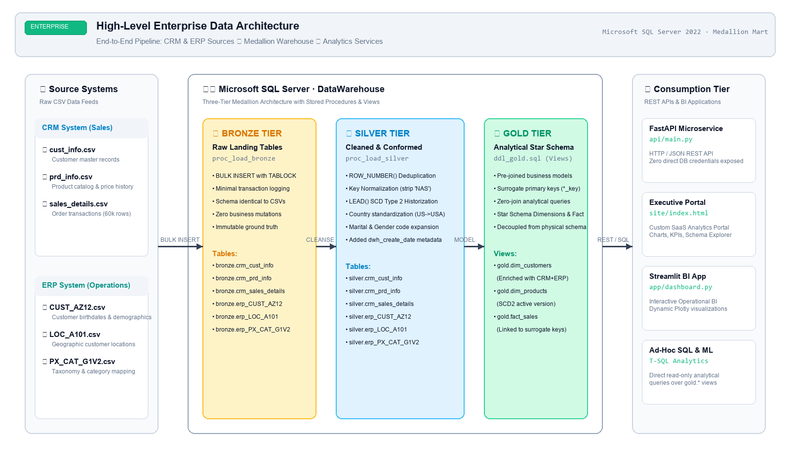
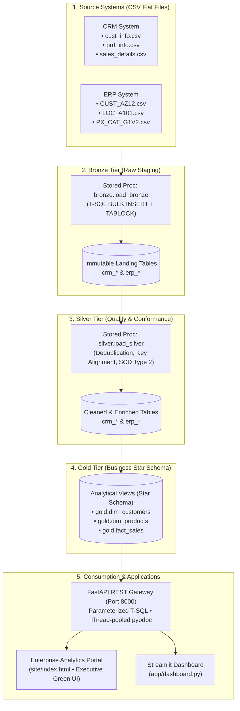
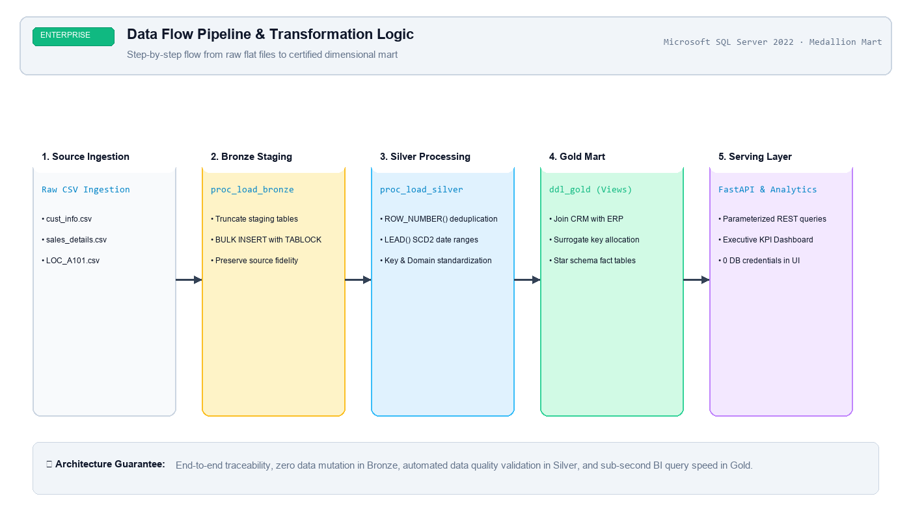

# Enterprise Sales Data Warehouse & Analytics Platform

An end-to-end data warehousing and business intelligence solution built on **SQL Server** using the **Medallion Architecture**, upgraded with an automated **Python ETL runner**, a **FastAPI** backend service, and an interactive **Streamlit** dashboard.

---

## 🏗️ Architecture & Data Flow

Data originates from two distinct business source systems (**CRM** and **ERP**) and flows through a three-layer Medallion architecture before being served to end-user applications:





>>>>>>> de5c988 (Refine design: Light mint/sage green background with frosted mirror glass cards, remove LICENSE, and embed visual architecture diagrams in README)

## 📖 System Overview & Medallion Design

### 1. Data Sources
* **CRM System:**
  * `cust_info.csv`: Customer accounts, registration dates, gender, and marital status.
  * `prd_info.csv`: Product catalog with pricing history and composite category keys.
  * `sales_details.csv`: Sales orders, line-item quantities, prices, and transaction dates.
* **ERP System:**
  * `CUST_AZ12.csv`: Customer birthdates and demographic identifiers.
  * `LOC_A101.csv`: Customer geographic locations and countries.
  * `PX_CAT_G1V2.csv`: Product taxonomy, categories, and maintenance indicators.

### 2. Processing Layers
* **Bronze (Raw Ingestion):**
  * Direct ingestion using T-SQL `BULK INSERT` with `TABLOCK` for minimal logging and high throughput.
  * Schema matches source files 1:1 without type enforcement or mutations.
* **Silver (Standardization & Quality):**
  * **Deduplication:** Windowed partitioning (`ROW_NUMBER() OVER (...)`) to isolate latest records.
  * **Key Normalization:** String manipulation (`SUBSTRING`, `REPLACE`) to resolve disparate CRM and ERP key conventions (e.g., stripping legacy prefixes like `NAS` and composite delimiters).
  * **Historization:** SCD Type 2 product end-date computation using `LEAD()`.
  * **Data Integrity:** Whitespace trimming, code standardizations (`M`/`S` $\rightarrow$ `Married`/`Single`), and audit metadata (`dwh_create_date`).
* **Gold (Business Dimension & Facts):**
  * Analytical Star Schema modeled through views.
  * **Dimensions:** `dim_customers`, `dim_products` (current version).
  * **Facts:** `fact_sales` (transaction metrics joined to dimensional surrogate keys).

---

## 📂 Repository Structure

```text
├── datasets/                 # Raw CSV files (CRM and ERP sources)
│   ├── cust_info.csv
│   ├── prd_info.csv
│   ├── sales_details.csv
│   ├── CUST_AZ12.csv
│   ├── LOC_A101.csv
│   └── PX_CAT_G1V2.csv
├── docs/                     # Schemas, data models, and architectural diagrams
├── scripts/                  # T-SQL Scripts
│   ├── bronze/               # DDL & bronze.load_bronze stored procedure
│   ├── silver/               # DDL & silver.load_silver stored procedure
│   └── gold/                 # DDL views (dim_customers, dim_products, fact_sales)
├── pipeline/
│   └── run_pipeline.py       # Python ETL execution runner with validation assertions
├── site/                     # Custom Enterprise Analytics Portal & Data Catalog UI
│   ├── index.html            # Interactive web portal
│   ├── css/style.css         # Modern vanilla CSS design system
│   ├── js/app.js             # Client application logic & chart rendering
│   ├── js/data.js            # Gold mart dimensional datasets & catalogs
│   └── assets/images/        # High-res architectural diagrams
├── api/
│   ├── __init__.py
│   └── main.py               # FastAPI backend with parameterized queries & portal mounting
├── app/
│   └── dashboard.py          # Multi-tab Streamlit dashboard
├── db.py                     # Context-managed pyodbc connection helper
├── .env.example              # Database and application environment template
├── .gitignore                # Git ignore configuration
├── requirements.txt          # Python dependencies
└── README.md

⚙️ Setup & Installation
Prerequisites
Python 3.10+

Microsoft SQL Server (Developer Edition or Express)

ODBC Driver for SQL Server (Version 17 or 18)

1. Database Initialization
Execute the SQL scripts inside SSMS or Azure Data Studio in the following sequence:

#scripts/bronze/ddl_bronze.sql
#scripts/bronze/proc_load_bronze.sql
#scripts/silver/ddl_silver.sql
#scripts/silver/proc_load_silver.sql
#scripts/gold/ddl_gold.sql

2. Application Setup
# Clone the repository
git clone <your-repo-url>
cd sql-data-warehouse-project

# Create and activate virtual environment
python -m venv .venv

# Windows:
.\.venv\Scripts\activate
# Linux/macOS:
source .venv/bin/activate

# Install required dependencies
pip install -r requirements.txt

# Configure environment variables
copy .env.example .env    # Linux/macOS: cp .env.example .env

Open .env and set your connection parameters:
DB_SERVER=localhost\SQLEXPRESS
DB_NAME=DataWarehouse
DB_DRIVER=ODBC Driver 18 for SQL Server
DB_TRUSTED=yes
API_URL=http://localhost:8000

🚀 Execution
Step 1: Run the ETL Pipeline
Executes the warehouse stored procedures, logs execution progress to logs/pipeline.log, and runs data-quality assertions (row count checks, primary key uniqueness, and fact fan-out validation):
# Full pipeline (Bronze -> Silver -> Validation)
python -m pipeline.run_pipeline

# Skip bronze loading if CSVs are already ingested:
python -m pipeline.run_pipeline --skip-bronze
Step 2: Start the FastAPI Service & Custom Web Portal
Launches the REST API backend and serves the custom interactive enterprise portal:

```bash
uvicorn api.main:app --reload
```

* **Interactive Enterprise Web Portal:** [http://localhost:8000/portal](http://localhost:8000/portal) (or simply open `site/index.html` in any browser)
* **Static Assets & Portal:** [http://localhost:8000/site/](http://localhost:8000/site/)
* **Interactive Swagger UI documentation:** [http://localhost:8000/docs](http://localhost:8000/docs)

Step 3: Launch the Streamlit Dashboard (Optional)
In a separate terminal window (with .venv active):
```bash
streamlit run app/dashboard.py
```

## 🔌 API Reference

| Endpoint | Method | Parameters | Description |
|---|---|---|---|
| `/health` | `GET` | — | Validates active database connectivity |
| `/kpis` | `GET` | — | Summary metrics (Total Sales, Orders, Volume, AOV) |
| `/customers` | `GET` | `country`, `limit`, `offset` | Paginated customer master directory |
| `/customers/{customer_id}` | `GET` | `customer_id` | Specific profile with lifetime order value |
| `/products` | `GET` | `category`, `limit`, `offset` | Active product dimension listings |
| `/sales` | `GET` | `start_date`, `end_date`, `limit`, `offset` | Enriched order line transactions |
| `/analytics/sales-by-country` | `GET` | — | Geographic revenue aggregation |
| `/analytics/sales-by-category` | `GET` | — | Category volume and revenue metrics |
| `/analytics/monthly-sales` | `GET` | — | Historical monthly revenue timeline |
| `/analytics/top-customers` | `GET` | `limit` | Ranked customer sales performance |
| `/analytics/top-products` | `GET` | `limit` | Ranked product SKU performance |

🛡️ Engineering Decisions
SQL Injection Prevention: All endpoints in the API layer use parameterized queries (? parameter binding) rather than dynamic string formatting.
Separation of Concerns: The Streamlit user interface communicates solely via HTTP/JSON through the FastAPI layer, ensuring database credentials and connection pools remain isolated from the presentation tier.
Pipeline Fault Tolerance: The Python pipeline monitors stored procedure execution buffers and intercepts custom SQL error banners within TRY...CATCH blocks, returning programmatic exit codes (0 or 1) for external orchestrators.
